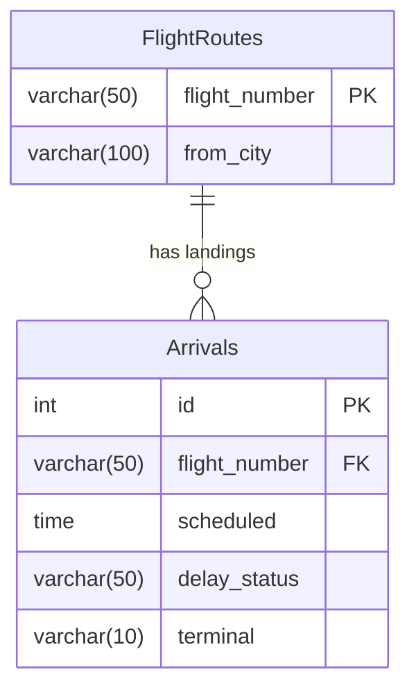

# Flight Arrivals Management System (`JDBC_FlightManager`)
**Course:** Software Engineering Methods (Academic Year 2026–2027)  
**Institution:** Braude College of Engineering | Department of Software Engineering  
**Database Engine:** MySQL 8.0+ | **Language:** Java 25 LTS (JDBC)

---

## 1. Project Description
This project implements a Flight Arrivals Data Access Layer (DAL) in Java using JDBC and MySQL. It covers importing raw flight data from CSV (`arrived_flights.csv`), normalizing the database schema into Third Normal Form (3NF) using AI assistance, performing secure and batched CRUD operations (`PreparedStatement` and `executeBatch`), and remediating a live SQL Injection vulnerability.

---

## 2. Engineering Team Details (Single-Workstation Driver–Navigator)
| Role | Full Name | Student ID | Braude Academic Email |
| :--- | :--- | :--- | :--- |
| **Student A** | `Mohamad Shalata` | `326564846` | `Mohamad.Shalata@e.braude.ac.il` |
| **Student B** | `Kamal Hamdony ` | `324833516` | `Kamal.Hamdony@e.braude.ac.il` |

* **Group Number:** `G[5]`
* **GitHub Repository URL:** `https://github.com/MohamadShalata/JDBC_FlightManager.git`

---

## 3. Technology Stack
* **Runtime & JDK:** BellSoft Liberica Full JDK 25 LTS
* **Database Server:** MySQL Server 8.0+ (`FlightDB` schema)
* **JDBC Driver:** MySQL Connector/J 9.5.0 (`mysql-connector-j-9.5.0.jar`)
* **IDE & Database Tooling:** IntelliJ IDEA Ultimate (Built-in Database Console & SQL Generator)
* **Local AI Assistant:** LM Studio (`Qwen2.5-Coder-7B-Instruct`) integrated via the Continue plugin
* **Version Control:** Git & GitHub

---

## 4. Database Normalization (3NF) & Functional Dependencies ($F$)
### 4.1 Functional Dependencies ($F$) in `rawflights`
In the unnormalized table `rawflights(scheduled, flight, fromC, delay, terminal)`, the origin city depends solely on the flight number:
$$\text{flight} \rightarrow \text{fromC}$$

### 4.2 Why `rawflights` Violated 3NF
Because `flight` is not a candidate key (the same flight number arrives multiple times on different schedules), the dependency $\text{flight} \rightarrow \text{fromC}$ caused severe data redundancy (repeating city names for the same flight) and three anomalies:
* **Update Anomaly:** Updating a flight's origin city required modifying multiple rows, risking inconsistent data.
* **Insertion Anomaly:** A new flight route could not be recorded unless an actual arrival schedule existed.
* **Deletion Anomaly:** Deleting the last arrival record for a flight erased its route information completely.

### 4.3 Decomposed 3NF Relational Schema
* **`FlightRoutes` (Parent Table):**
    * `flight_number` (`VARCHAR(50)`, **Primary Key**)
    * `from_city` (`VARCHAR(100)`)
* **`Arrivals` (Child Table):**
    * `id` (`INT AUTO_INCREMENT`, **Primary Key**)
    * `flight_number` (`VARCHAR(50)`, **Foreign Key** referencing `FlightRoutes(flight_number)`)
    * `scheduled` (`TIME`)
    * `delay_status` (`VARCHAR(50)`)
    * `terminal` (`VARCHAR(10)`)

---

## 5. Independent AI Prompt (Part 4 – `FlightViewer.java`)
```text
Write a complete Java class named FlightViewer with a main method.
Prompt the user via Scanner for the MySQL root password and connect to FlightDB using try-with-resources with URL: "jdbc:mysql://localhost:3306/FlightDB?allowLoadLocalInfile=true&allowPublicKeyRetrieval=true&serverTimezone=Asia/Jerusalem&useSSL=false" and user "root".
Then prompt the user via Scanner for a target terminal number (e.g., 2, 3, 4, or 5).
Use a secure PreparedStatement with '?' to execute a SELECT query with an INNER JOIN between Arrivals and FlightRoutes on flight_number, selecting Arrivals.id, Arrivals.flight_number, FlightRoutes.from_city, Arrivals.scheduled, Arrivals.delay_status, and Arrivals.terminal, filtering WHERE Arrivals.terminal = ? and sorting ORDER BY Arrivals.scheduled ASC.
Bind the parameter using pstmt.setString(1, terminal) and print the formatted results cleanly to the console.
```

---

## 6. Entity Relationship Diagram (ERD)


---

## 7. Security Audit Summary (Part 5 – SQL Injection Mitigation)
* **Attack Payload Tested:** `Landed' #`
* **Vulnerability Analysis (`Statement`):** Using raw string concatenation (`"UPDATE Arrivals SET delay_status = '" + userInput + "' WHERE flight_number = 'LX354'"`) allowed the single quote (`'`) to prematurely close the SQL string literal and the `#` character to comment out the `WHERE` clause. As a result, MySQL executed `UPDATE Arrivals SET delay_status = 'Landed'` and overwrote all 299 rows.
* **Remediation (`PreparedStatement`):** Refactoring to a parameterized query (`UPDATE Arrivals SET delay_status = ? WHERE flight_number = 'LX354'`) pre-compiles the SQL structure separately from user data. The database treats `Landed' #` strictly as a literal string value, updating only the single target row (`LX354`).

---

## 8. License
Distributed under the Braude College Academic License (Software Engineering Methods, 2026–2027).